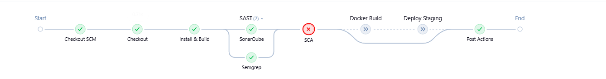
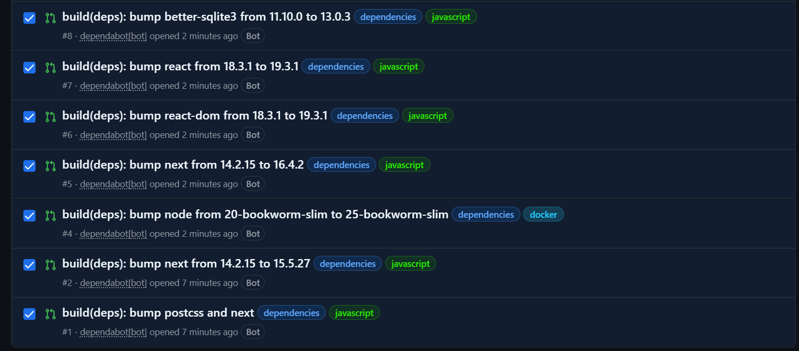
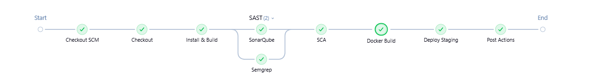

# DevSecOps Workshop

Application Next.js **volontairement vulnérable** + pipeline Jenkins avec analyse de sécurité automatisée :
SAST (SonarQube, Semgrep), SCA (OWASP Dependency-Check) et mises à jour automatiques (Dependabot).

⚠️ Ne jamais déployer en production.

## Sommaire

1. [Démarrer l'infra](#1-démarrer-linfra)
2. [Configurer Jenkins](#2-configurer-jenkins)
3. [Pipeline](#3-pipeline)
4. [Configurer le Quality Gate SonarQube](#4-configurer-le-quality-gate-sonarqube)
5. [Vulnérabilités plantées](#5-vulnérabilités-plantées)
6. [Lancer l'app sans Jenkins](#6-lancer-lapp-sans-jenkins)
7. [SCA : analyse des dépendances](#7-sca--analyse-des-dépendances)
8. [Résultats : avant / après](#8-résultats--avant--après)
9. [Dépannage](#9-dépannage)
10. [Organisation du travail en équipe](#10-organisation-du-travail-en-équipe)

## 1. Démarrer l'infra

```bash
# Linux uniquement (requis par SonarQube/Elasticsearch)
sudo sysctl -w vm.max_map_count=262144

docker compose up -d --build
```

| Service   | URL                   | Accès initial                                   |
|-----------|-----------------------|-------------------------------------------------|
| Jenkins   | http://localhost:8080 | mot de passe : `docker logs jenkins`            |
| SonarQube | http://localhost:9000 | admin / admin (changement demandé au 1er login) |
| Staging   | http://localhost:3001 | créé par le pipeline                            |

### Docker Desktop (Windows / Mac)

- Allouer au moins **6 Go de RAM** à Docker Desktop (*Settings > Resources*). Sous Windows (WSL2), créer `C:\Users\<vous>\.wslconfig` avec `[wsl2]` puis `memory=6GB`, et exécuter `wsl --shutdown`.
- Si SonarQube s'arrête au démarrage (`vm.max_map_count too low`), exécuter à chaque redémarrage de Docker Desktop :
  ```
  wsl -d docker-desktop sysctl -w vm.max_map_count=262144
  ```
- Éviter les fins de ligne CRLF qui cassent les scripts du Jenkinsfile : `git config --global core.autocrlf input`.
- Jenkins tourne dans un conteneur : le dépôt Git doit être **distant** (GitHub, GitLab, Gitea), pas un chemin local.

## 2. Configurer Jenkins

À faire une seule fois, après `docker compose up`.

1. Ouvrir http://localhost:8080, saisir le mot de passe initial (`docker logs jenkins`) et terminer l'assistant. Les plugins nécessaires sont déjà préinstallés.
2. **SonarQube** : *My Account > Security > Generate Tokens* (type *User*), puis copier le token.
3. **Credential Sonar** : Jenkins > *Manage Jenkins > Credentials > Global > Add Credentials*
   - Kind : **Secret text**, Secret : le token Sonar, ID : **`sonar-token`**
4. **Clé API NVD** (stage SCA) : demander une clé gratuite sur https://nvd.nist.gov/developers/request-an-api-key (reçue par e-mail), puis l'ajouter de la même façon :
   - Kind : **Secret text**, Secret : la clé NVD, ID : **`nvd-api-key`**
5. Pousser ce projet sur un dépôt Git.
6. Jenkins : *New Item > Pipeline > Pipeline script from SCM* > Git > URL du dépôt, branche, Script Path `Jenkinsfile`.
7. **Build Now**.

> Le projet SonarQube n'a pas besoin d'être créé : il l'est au premier scan grâce à `sonar.projectKey` dans `sonar-project.properties`.

> Pour exécuter le pipeline sur chaque branche et chaque PR (y compris celles de Dependabot), utiliser un job **Multibranch Pipeline** à la place d'un Pipeline simple.

## 3. Pipeline

`Checkout` > `Install & Build` > `SAST (SonarQube || Semgrep)` > `SCA` > `Docker Build` > `Deploy Staging` > `DAST`
Les stages `SAST` et `SCA` **font échouer le build** en cas de violation :

| Stage | Outil | Condition d'échec |
|---|---|---|
| SAST | SonarQube | Quality Gate en échec (`sonar.qualitygate.wait=true`, timeout 5 min) |
| SAST | Semgrep | Au moins une règle déclenchée (`--error`) |
| SCA | OWASP Dependency-Check | Dépendance avec une CVE de score CVSS >= 7 (`--failOnCVSS 7`) |
| DAST | OWASP ZAP | Observation uniquement pour l'instant (échec seulement si ZAP lui-même plante) |

- Les deux scanners SAST tournent en parallèle et vont jusqu'au bout, donc les deux rapports sont toujours produits.
- Si un scan échoue, `Docker Build` et `Deploy Staging` ne sont pas exécutés.
- Le staging est déployé sur le réseau Docker `devsecops` et exposé sur http://localhost:3001.

Rapports :
- Semgrep : artefacts du build (`semgrep-report.json`, `semgrep.sarif`)
- Dependency-Check : artefacts du build (`dependency-check-report/`, HTML et JSON)
- SonarQube : http://localhost:9000, projet `devsecops-workshop`
- ZAP : artefacts du build (`zap-report/zap-report.html` et `.json`)

## 4. Configurer le Quality Gate SonarQube

Ne pas utiliser le gate par défaut "Sonar way", et **ne pas le copier** : il porte sur le *nouveau code* et exige 80 % de couverture de tests et une limite de duplication. Le projet n'a pas de tests, donc le build échouerait pour une mauvaise raison. Créer un gate vierge.

1. SonarQube > **Quality Gates** > **Create** > nom : `Workshop Gate`
2. Ajouter ces conditions sur **Overall Code** :
   - Security Rating pire que **A**
   - Reliability Rating pire que **A**
   - Security Hotspots Reviewed inférieur à **100 %** (si la condition est proposée)
3. Ne mettre **aucune** condition de couverture ni de duplication.
4. **Set as Default**, puis vérifier dans *Project Settings > Quality Gate* du projet que `Workshop Gate` est bien celui utilisé.

> La condition sur les Security Hotspots est importante : SonarQube Community détecte mal les injections (pas d'analyse de taint) et classe plusieurs failles (MD5, `Math.random()`, `exec()`, secrets) en hotspots. Semgrep, lui, détecte les injections : c'est un bon point de discussion sur la complémentarité des outils.

> Le statut affiché dans SonarQube est celui du **dernier scan**. Après un changement de gate, relancer le build pour le recalculer.

## 5. Vulnérabilités plantées

Ce tableau décrit l'état **initial** (avant correction, voir section 8).

| Vulnérabilité               | Fichier                          | Test manuel                                                    |
|-----------------------------|----------------------------------|----------------------------------------------------------------|
| SQL injection (auth bypass) | `app/api/login/route.js`         | user : `admin' --`, mot de passe quelconque                    |
| SQL injection (UNION)       | `app/api/search/route.js`        | `' UNION SELECT id, username, password FROM users --`          |
| XSS stocké                  | `app/comments/page.js`           | commentaire : ``                   |
| Command injection           | `app/api/ping/route.js`          | `/api/ping?host=127.0.0.1;id`                                  |
| Path traversal              | `app/api/file/route.js`          | `/api/file?name=../../package.json`                            |
| Secrets en dur              | `lib/config.js`                  | -                                                              |
| Hash faible (MD5)           | `lib/crypto.js`                  | -                                                              |
| Cookie non sécurisé         | `app/api/login/route.js`         | -                                                              |
| Fuite d'erreur SQL          | `app/api/login/route.js`         | `'` dans le champ user                                         |
| Conteneur en root           | `Dockerfile`                     | détecté par Semgrep                                            |
| Dépendances vulnérables     | `package.json` (`next@14.2.15`)  | détecté par Dependency-Check (voir section 7)                  |

## 6. Lancer l'app sans Jenkins

Prérequis : **Node.js 22 ou plus** (exigé par `better-sqlite3` 13) et les outils de compilation C++ (`make`, `g++`), car `better-sqlite3` se compile à l'installation. Sous Windows, le plus simple est d'utiliser Docker :

```bash
docker build -t devsecops-app .
docker run --rm -p 3000:3000 devsecops-app
```

Ou en local sous Linux / Mac :

```bash
npm install
npm run dev   # http://localhost:3000
```

## 7. SCA : analyse des dépendances

Le SAST analyse **notre** code, le SCA analyse les **dépendances** (CVE connues).

| Outil | Rôle | Où ça tourne | Détails |
|---|---|---|---|
| OWASP Dependency-Check | Détecte les CVE et fait échouer le build (CVSS >= 7) | Jenkins, stage `SCA` | [docs/sca-dependency-check.md](docs/sca-dependency-check.md) |
| Dependabot | Ouvre des Pull Requests de mise à jour | GitHub | [docs/dependabot.md](docs/dependabot.md) |

Dependency-Check **détecte et bloque** dans le pipeline, Dependabot **propose le correctif** sous forme de PR, et le pipeline vérifie cette PR avant le merge.

Points clés :
- Prérequis : credential Jenkins `nvd-api-key` (voir section 2).
- Le premier build télécharge la base NVD (plusieurs minutes avec une clé API) ; elle est ensuite conservée dans le volume `jenkins_home`.
- Le scan exclut `node_modules` et désactive l'analyseur Sonatype OSS Index (`--disableOssIndex`), qui échoue sans authentification et ralentit fortement le scan.
- Dependabot nécessite un dépôt **GitHub**. Avec GitLab ou Gitea, utiliser Renovate.

### Avant / après

Le projet utilisait volontairement `next@14.2.15`, qui contient des vulnérabilités connues.

**Avant** : le stage `SCA` échoue.



**Correction** : Dependabot ouvre des Pull Requests de mise à jour, validées par le pipeline avant le merge.



| PR | Mise à jour | Décision |
|---|---|---|
| #1 | `postcss` et `next` | Remplacée par #5 |
| #2 | `next` 14.2.15 vers 15.5.27 | Fermée (même dépendance que #5) |
| #5 | `next` 14.2.15 vers 16.4.2 | **Mergée** |
| #6 et #7 | `react-dom` et `react` 18.3.1 vers 19.3.1 | **Mergées** (les deux doivent avoir la même version majeure) |
| #8 | `better-sqlite3` 11.10.0 vers 13.0.3 | **Mergée** (impose Node >= 22) |
| #4 | image `node` 20 vers 25 | **Refusée** : Node 25 n'est pas une version LTS. Passage manuel à Node 22. |

Versions obtenues :

| Dépendance | Avant | Après |
|---|---|---|
| `next` | 14.2.15 | 16.4.2 |
| `react` / `react-dom` | 18.3.1 | 19.3.1 |
| `better-sqlite3` | 11.10.0 | 13.0.3 |
| Node.js (image Jenkins et image de l'app) | 20 | 22 (choix manuel) |

**Après** : le stage `SCA` passe et le build continue jusqu'au staging.



### Points d'attention rencontrés

- Dependabot peut proposer des mises à jour **majeures** qui cassent le build : toujours exécuter le pipeline sur la PR avant de merger.
- `react` et `react-dom` doivent avoir la même version majeure.
- `better-sqlite3` 13 se compile à l'installation : les images Jenkins et de l'app embarquent `make` et `g++`.
- Les images Docker restent sur une version **LTS** de Node, alignée entre Jenkins et l'app (règle `ignore` dans `.github/dependabot.yml`).
- Semgrep analyse aussi `.github/dependabot.yml` : il impose un `cooldown` de 7 jours avant de proposer une version fraîchement publiée (protection contre les paquets compromis). Les mises à jour de sécurité ne sont pas retardées.

## 7 bis. DAST : OWASP ZAP

Le SAST et le SCA analysent le code et les dépendances. Le DAST attaque l'application **déployée**, de l'extérieur.

| Scan | Quand | Ce qu'il fait |
|---|---|---|
| Baseline (passif) | À chaque build, stage `DAST` | Explore l'application et analyse les réponses (en-têtes, cookies). N'envoie aucune attaque. |
| Complet (actif) | Build avec le paramètre `ZAP_ACTIVE_SCAN` | Envoie de vraies charges d'attaque (XSS, injections). Staging uniquement. |

- **Cible** : `http://devsecops-staging:3000` (réseau Docker `devsecops`).
- **Mode** : observation, les alertes ne font pas échouer le build.
- **Rapports** : artefacts du build (`zap-report/`).
- **Détails** (lancement manuel, lecture du rapport, scan actif, discussion CI/CD) : [docs/zap.md](docs/zap.md)

### Avant / après

**Avant** : alertes sur les en-têtes de sécurité manquants.


**Après** : en-têtes ajoutés dans `next.config.js`.


## 8. Résultats : avant / après

Le pipeline est d'abord exécuté sur le code **vulnérable**, puis sur le code **corrigé**.

### 8.1 Avant : code vulnérable

Le build échoue au stage `SAST` : le Quality Gate SonarQube est en échec et Semgrep bloque sur ses findings. Les stages suivants ne sont pas exécutés.

**Pipeline Jenkins**


**Semgrep** : 4 findings bloquants (251 règles, 26 fichiers analysés)


**SonarQube** : Quality Gate *Failed* (Security D, Reliability C)


### 8.2 Corrections appliquées

| Vulnérabilité | Fichier | Correctif |
|---|---|---|
| Injection SQL (login) | `app/api/login/route.js` | Requête paramétrée (`?`) |
| Injection SQL (recherche) | `app/api/search/route.js` | Requête paramétrée (`LIKE ?`) |
| XSS stocké | `app/comments/page.js` | Rendu en texte (`{c.body}`), suppression de `dangerouslySetInnerHTML` |
| Injection de commande | `app/api/ping/route.js` | Suppression de `exec`, résolution via `dns.lookup` + validation du format |
| Path traversal | `app/api/file/route.js` | Liste blanche des fichiers du dossier autorisé |
| Secrets en dur | `lib/config.js` | Lecture de `SESSION_SECRET` (env) ou secret aléatoire |
| Hash MD5 | `lib/crypto.js` | `scrypt` avec sel aléatoire et comparaison à temps constant |
| Cookie non sécurisé | `app/api/login/route.js` | `HttpOnly`, `Secure`, `SameSite=Strict`, jeton via `crypto.randomBytes` |
| Fuite d'erreurs SQL | routes API | Message générique côté client, détail dans les logs serveur |
| Promesses non gérées (Sonar S9383) | `app/comments/page.js` | `void load()` |
| Conteneur en root | `Dockerfile` | `USER node` (utilisateur non-root) |
| Dépendances vulnérables | `package.json` | Mises à jour via Dependabot (voir section 7) |

### 8.3 Après : code corrigé

Les scans passent et le build continue jusqu'au déploiement du staging (http://localhost:3001).

**Pipeline Jenkins**


**Semgrep** : 0 finding


**SonarQube** : Quality Gate *Passed*


### 8.4 Résumé

| | Avant | Après |
|---|---|---|
| Semgrep | 4 findings (bloquant) | 0 finding |
| SonarQube | Gate *Failed* (Security D, Reliability C) | Gate *Passed* |
| Dependency-Check | Échec (CVE sur `next`) | Succès |
| Pipeline | Échec au stage SAST | Succès, staging déployé |

## 9. Dépannage

| Symptôme | Cause | Solution |
|---|---|---|
| `docker: not found` dans un stage Jenkins | Docker CLI absent de l'image Jenkins | Vérifier `jenkins/Dockerfile`, puis `docker compose build jenkins && docker compose up -d jenkins` |
| `docker exec jenkins node -v` affiche encore `v20` après un build | Le conteneur n'a pas été recréé | `docker compose up -d jenkins` |
| `EBADENGINE` et `not found: make` pendant `npm ci` | `better-sqlite3` 13 exige Node >= 22 et se compile à l'installation | Node 22 et `build-essential` dans `jenkins/Dockerfile` ; Node 22, `python3`, `make`, `g++` dans le `Dockerfile` de l'app |
| Le Quality Gate échoue alors que Security, Reliability et Maintainability sont à A | Gate copié depuis "Sonar way" (condition de couverture 80 %) | Supprimer les conditions Coverage et Duplicated Lines, voir section 4 |
| Semgrep : `dependabot-missing-cooldown` | `.github/dependabot.yml` sans `cooldown` | Ajouter `cooldown: default-days: 7` à chaque entrée |
| Le stage `SCA` dure très longtemps, avec des `[WARN]` OSS Index | Scan de `node_modules` et analyseur OSS Index actif | `--exclude "**/node_modules/**"` et `--disableOssIndex` |
| Conflit sur une PR Dependabot | `main` a avancé depuis la création de la PR | Commenter `@dependabot rebase` sur la PR (ne pas résoudre le lockfile à la main) |
| Dependabot propose une image Node non LTS (ex. Node 25) | Mise à jour majeure automatique | Règle `ignore` sur `node` dans `.github/dependabot.yml` |
| `/api/comments` renvoie une erreur 500 en local | `better-sqlite3` non compilé sur la machine | Utiliser Docker (section 6) ou Node 22 avec les outils de compilation |
| Stage `DAST` en erreur (code 3) | Cible injoignable : le staging n'est pas démarré ou n'est pas sur le réseau `devsecops` | Vérifier le stage `Deploy Staging` et `docker ps` |
| Le premier build `DAST` est très long | Téléchargement de l'image ZAP (environ 1 Go) | Normal, les builds suivants sont rapides. Ou : `docker pull ghcr.io/zaproxy/zaproxy:stable` |
| Le paramètre `ZAP_ACTIVE_SCAN` n'apparaît pas | Jenkins enregistre les paramètres après le premier build du nouveau Jenkinsfile | Lancer un premier build, puis utiliser *Build with Parameters* |
| ZAP ne trouve aucune alerte de cookie | Le scan passif ne se connecte pas, donc ne voit pas le cookie de `/api/login` | Voir docs/zap.md, section sur les cookies |

## 10. Organisation du travail en équipe

### Règles

- `main` est protégée : toute modification passe par une Pull Request relue par un autre membre.
- Une branche par tâche, créée depuis `main` à jour : `feature/<nom>` ou `docs/<nom>`.
- Chaque tâche documente son travail dans son propre fichier `docs/<nom>.md`, et le README ne contient qu'un résumé et un lien. Cela évite les conflits de merge.
- Avant de merger une PR Dependabot, vérifier que le pipeline passe sur sa branche.

### Répartition des tâches

| # | Tâche | Branche | Documentation | Statut |
|---|---|---|---|---|
| 1 | SAST : SonarQube et Semgrep | `main` | README sections 3 et 4 | Fait |
| 2 | OWASP Dependency-Check | `feature/sca-dependency-check` | [docs/sca-dependency-check.md](docs/sca-dependency-check.md) | Fait |
| 3 | Dependabot | `feature/dependabot` | [docs/dependabot.md](docs/dependabot.md) | Fait |
| 4 | Gitleaks (secrets) | `feature/secrets-gitleaks` | `docs/gitleaks.md` | À faire |
| 5 | Trivy (image Docker) | `feature/image-trivy` | `docs/trivy.md` | À faire |
| 6 | OWASP ZAP (DAST) | `feature/dast-zap` | `docs/zap.md` | À faire |

Les tâches 4 à 6 modifient chacune le `Jenkinsfile` : les merger l'une après l'autre en rebasant (`git pull --rebase origin main`) avant chaque PR.