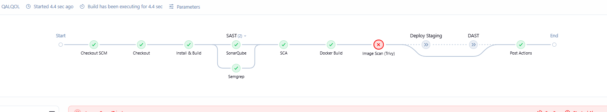
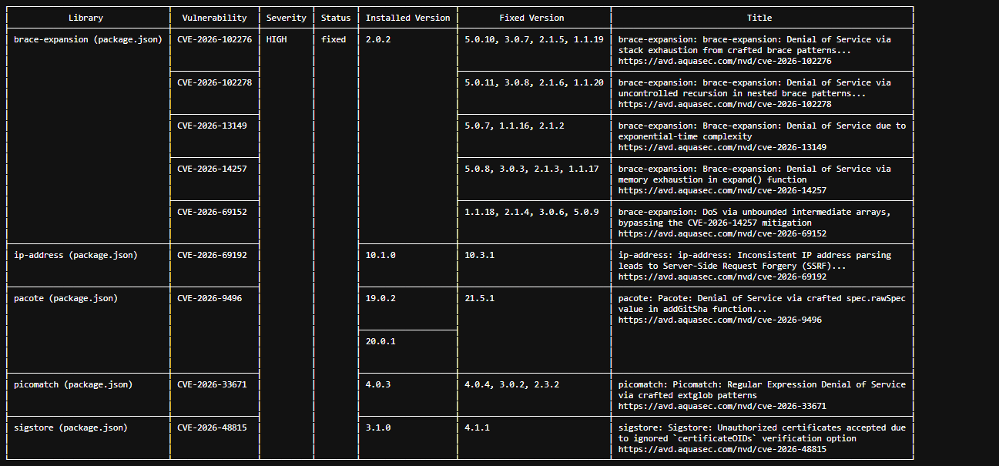
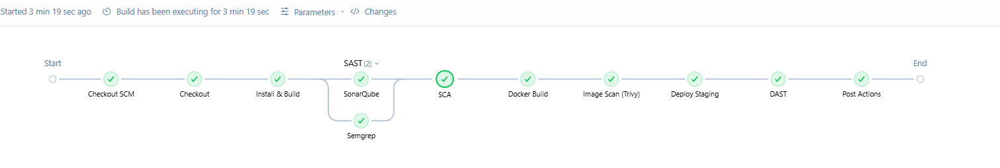
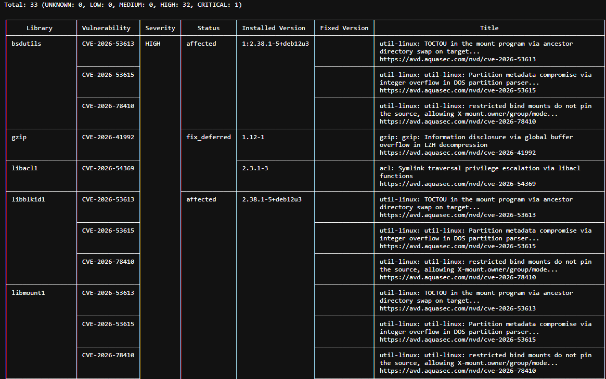

# Scan d'image Docker : Trivy

**Objectif** : analyser l'image Docker de l'application pour identifier des vulnérabilités (CVE), des mauvaises configurations et d'éventuels secrets exposés, se concentrer sur les niveaux **HIGH** et **CRITICAL**, proposer des remédiations, puis bloquer le pipeline à partir d'un seuil de sévérité.

## Ce que Trivy analyse

| Analyse | Option Trivy | Ce qu'il cherche |
|---|---|---|
| Vulnérabilités | `--scanners vuln` | CVE dans les paquets de l'OS de l'image (Debian) et dans les dépendances applicatives (`node_modules`, npm embarqué dans l'image Node) |
| Secrets | `--scanners secret` et `--image-config-scanners secret` | clés, jetons et mots de passe présents dans les fichiers de l'image ou dans sa configuration (variables d'environnement, commandes de build) |
| Mauvaises configurations | `--image-config-scanners misconfig` | pratiques risquées du Dockerfile telles que l'image la révèle : exécution en root, absence de `HEALTHCHECK`, etc. |

Trivy complète les autres outils du pipeline : Semgrep et SonarQube analysent le code, Dependency-Check analyse `package.json`, ZAP attaque l'application. Trivy est le seul à regarder **l'image finale**, c'est-à-dire l'OS de base et tout ce qu'on y a installé.

## Sécurité de l'outil lui-même

En mars 2026, la chaîne de distribution de Trivy a été compromise : les versions **0.69.4** (binaire et images), **0.69.5** et **0.69.6** (images Docker Hub) contenaient du code malveillant volant des secrets, et plusieurs GitHub Actions ont été détournées (avis GHSA-69fq-xp46-6x23, CVE-2026-33634). Un scanner de sécurité tourne souvent avec accès à des secrets : il faut l'installer avec autant de soin que le reste.

Ce que fait le workshop :
- **version épinglée** (`TRIVY_VERSION` dans `jenkins/Dockerfile`), jamais `latest` ;
- **archive téléchargée depuis une version publiée** (URL de release versionnée), pas le script `install.sh` de la branche `main`, qui est mutable ;
- **pas de GitHub Action tierce** : Trivy est installé dans l'image Jenkins ;
- **version choisie ancienne d'au moins deux semaines**, pour laisser le temps de détecter un problème.

Pour aller plus loin, la release publie un fichier de signature (`.sigstore.json`) vérifiable avec `cosign verify-blob`. La procédure est dans l'avis ci-dessus.

## Fonctionnement dans le pipeline

Pipeline : `Checkout` > `Install & Build` > `SAST` > `SCA` > `Docker Build` > **`Image Scan (Trivy)`** > `Deploy Staging` > `DAST`

Le scan est placé **avant** le déploiement : une image qui dépasse le seuil n'arrive jamais sur le staging.

1. **Rapport complet**, ne bloque jamais : toutes les vulnérabilités HIGH et CRITICAL (corrigées ou non), les secrets et les mauvaises configurations. Sorties : `trivy-report/trivy-report.json`, `.txt` (tableau) et `.html`, archivées avec le build.
2. **Garde-fou** : le build échoue si le rapport ne contient pas l'analyse de l'OS. Un scan qui n'a rien analysé sortirait avec le code 0 et passerait pour un succès.
3. **Seuil de blocage**, choisi par le paramètre `TRIVY_BLOCK_SEVERITY` :

| Valeur | Effet |
|---|---|
| `HIGH,CRITICAL` (défaut) | le build échoue s'il reste une vulnérabilité HIGH ou CRITICAL **avec correctif disponible**, un secret ou une mauvaise configuration de ce niveau |
| `CRITICAL` | seuil plus permissif : seuls les CRITICAL bloquent |
| `NONE` | observation uniquement : rapports produits, aucun blocage |

Par défaut, le blocage ignore les vulnérabilités sans correctif publié (`--ignore-unfixed`, paramètre `TRIVY_IGNORE_UNFIXED` à `true`) : aucune action n'est possible dessus. Elles restent visibles dans le rapport complet. Décocher le paramètre les compte aussi dans le blocage.

- **Bandeau VEX** : Trivy ajoute un bandeau destiné aux mainteneurs de logiciels libres en tête de ses rapports. Le stage le désactive avec `TRIVY_DISABLE_VEX_NOTICE`.
- **Cache** : la base de vulnérabilités est stockée dans `/var/jenkins_home/trivy-cache` (volume `jenkins_home`). Le premier build la télécharge, les suivants sont rapides.
- **Réseau** : Jenkins doit pouvoir joindre `ghcr.io` pour récupérer la base.

## Lancer Trivy à la main

Trivy est installé dans le conteneur Jenkins, qui accède aux images locales via le socket Docker. L'image doit exister (un build du pipeline suffit).

```bash
docker exec jenkins trivy --version

# Vulnérabilités HIGH et CRITICAL de l'image de l'application
docker exec jenkins trivy image --cache-dir /var/jenkins_home/trivy-cache \
  --severity HIGH,CRITICAL devsecops-app:latest

# Secrets et mauvaises configurations, tous niveaux de sévérité
docker exec jenkins trivy image --cache-dir /var/jenkins_home/trivy-cache \
  --scanners secret --image-config-scanners misconfig,secret \
  --severity LOW,MEDIUM,HIGH,CRITICAL devsecops-app:latest

# Comparaison : que vient de l'image de base ?
docker exec jenkins trivy image --cache-dir /var/jenkins_home/trivy-cache \
  --severity HIGH,CRITICAL node:22-bookworm-slim
```

Le filtre de sévérité masque des constats utiles : une mauvaise configuration comme l'absence de `HEALTHCHECK` est classée LOW et n'apparaît pas dans la vue HIGH et CRITICAL. La deuxième commande les affiche.

Si Trivy refuse une option, vérifier ses noms avec `trivy image --help` : ils évoluent entre versions.

## Lire le rapport

Pour chaque vulnérabilité, le tableau indique :

| Colonne | Sens |
|---|---|
| Library | le paquet concerné (par exemple une bibliothèque Debian, ou un module npm) |
| Vulnerability | l'identifiant (CVE ou GHSA) |
| Severity | CRITICAL, HIGH, MEDIUM, LOW |
| Status | `fixed` (un correctif existe), `affected` (pas encore de correctif), `will_not_fix` (l'éditeur ne corrigera pas), `end_of_life` |
| Installed Version | la version présente dans l'image |
| Fixed Version | la version qui corrige la faille |

### Comment prioriser

1. **Un correctif existe** (`fixed`) : à traiter d'abord, car l'action est connue.
2. **D'où vient le paquet ?**
   - paquet de l'OS de base : se corrige en mettant à jour l'image de base ;
   - module npm de l'application : se corrige avec Dependabot et le SCA ;
   - outils présents dans l'image mais inutiles à l'exécution (npm, compilateurs) : se corrige en les retirant.
3. **La faille est-elle atteignable ?** Une vulnérabilité dans un outil de build absent de l'exécution compte moins qu'une vulnérabilité dans un paquet chargé par l'application. Trivy ne le sait pas : c'est un jugement à porter.
4. **Faux positifs possibles** : le scan de secrets peut signaler des fichiers de test embarqués dans `node_modules` (clés d'exemple). À vérifier avant de conclure.

## Résultats du scan de l'image actuelle

Premier scan avec le seuil par défaut (`HIGH,CRITICAL`, correctif disponible), sur l'image construite par le Dockerfile en une seule étape.





Le stage `Image Scan (Trivy)` échoue : `Deploy Staging` et `DAST` ne sont pas exécutés. Les stages précédents (SAST, SCA, Docker Build) sont passés.

Le rapport liste **9 vulnérabilités de niveau HIGH sur 5 paquets Node.js**, toutes avec un correctif disponible :

| Paquet | Version installée | Vulnérabilités | Nature | Version corrigée |
|---|---|---|---|---|
| `brace-expansion` | 2.0.2 | 5 (CVE-2026-102276, -102278, -13149, -14257, -69152) | déni de service par des motifs d'accolades malveillants | 2.1.6 (branche 2.x) |
| `ip-address` | 10.1.0 | CVE-2026-69192 | analyse d'adresse IP incohérente, pouvant mener à une SSRF | 10.3.1 |
| `pacote` | 19.0.2 et 20.0.1 | CVE-2026-9496 | déni de service | 21.5.1 |
| `picomatch` | 4.0.3 | CVE-2026-33671 | déni de service par expression régulière | 4.0.4 |
| `sigstore` | 3.1.0 | CVE-2026-48815 | certificats non autorisés acceptés (option de vérification ignorée) | 4.1.1 |

### D'où viennent ces paquets ?

Aucun de ces cinq paquets n'apparaît dans le `package-lock.json` du projet, qui ne contient que `next`, `react`, `react-dom`, `better-sqlite3` et leurs dépendances. Ils proviennent très probablement de **npm lui-même**, livré avec l'image de base Node et utilisé uniquement pour construire l'application.

Vérification : chaque constat du rapport JSON porte le chemin du fichier analysé.

```bash
grep PkgPath trivy-report/trivy-report.json | sort -u
```

Des chemins du type `usr/local/lib/node_modules/npm/node_modules/...` confirment l'origine.

### Ce que ce résultat montre

- **Trivy voit ce que les autres outils ne voient pas.** Dependency-Check analyse les fichiers du dépôt et est passé : ces paquets n'existent que dans l'image finale.
- **Le risque réel est plus faible que le niveau affiché.** npm n'est pas utilisé par l'application à l'exécution. Mais ces paquets sont dans l'image, donc ils bloquent le seuil, et les retirer ne coûte rien.
- **La correction est dans le Dockerfile, pas dans le code** : ne pas livrer npm dans l'image finale (build en deux étapes, voir « Remédiation »).

## Remédiation

### 1. Mettre à jour l'image

- **Reconstruire avec `--pull`** : sans cette option, Docker réutilise l'image de base en cache, même si une version corrigée est publiée. Le stage `Docker Build` utilise `docker build --pull`.
- **Choisir une version de base récente** : une nouvelle version mineure de Node embarque souvent les correctifs de l'OS et de npm.
- **Autre image de base** : `node:22-alpine` contient en général moins de paquets, donc moins de CVE d'OS, mais utilise une autre bibliothèque C (musl) : à tester avant adoption, en particulier avec `better-sqlite3`.
- **Épingler l'image par empreinte** (`FROM node:22-bookworm-slim@sha256:...`) rend le build reproductible. Dependabot propose ensuite les mises à jour d'empreinte.

### 2. Durcir le Dockerfile

```dockerfile
# ---------- Étape de build : les compilateurs restent ici ----------
FROM node:22-bookworm-slim AS builder
WORKDIR /app
RUN apt-get update \
    && apt-get install -y --no-install-recommends python3 make g++ \
    && rm -rf /var/lib/apt/lists/*
COPY package*.json ./
RUN npm ci
COPY . .
RUN npm run build

# ---------- Image finale : ni compilateurs, ni npm ----------
FROM node:22-bookworm-slim
ENV NODE_ENV=production
WORKDIR /app

# npm et yarn ne servent pas à l'exécution : on retire leurs dépendances embarquées
RUN rm -rf /usr/local/lib/node_modules/npm /usr/local/bin/npm /usr/local/bin/npx \
           /opt/yarn-* /usr/local/bin/yarn /usr/local/bin/yarnpkg \
    && chown node:node /app

COPY --from=builder --chown=node:node /app ./

USER node
EXPOSE 3000

HEALTHCHECK --interval=30s --timeout=5s --start-period=30s --retries=3 \
  CMD node -e "fetch('http://127.0.0.1:3000/').then(r=>process.exit(r.ok?0:1)).catch(()=>process.exit(1))"

CMD ["node", "node_modules/next/dist/bin/next", "start"]
```

| Changement | Effet |
|---|---|
| Build en deux étapes | `python3`, `make` et `g++` ne sont plus dans l'image finale : moins de paquets, donc moins de CVE, et moins d'outils pour un attaquant |
| Suppression de npm et yarn | retire les dépendances embarquées de npm, source fréquente de CVE dans les images Node |
| `USER node` | le processus ne tourne pas en root |
| `HEALTHCHECK` | Docker sait détecter une application qui ne répond plus (alerte de configuration de Trivy) |
| `npm ci` | installation reproductible à partir de `package-lock.json` |

### 3. Dépendances applicatives

Les modules npm vulnérables se corrigent comme dans la partie SCA : Dependabot ouvre la PR, le pipeline la valide avant le merge.

### 4. Accepter un risque

Si une vulnérabilité ne peut pas être corrigée et n'est pas atteignable, l'ajouter dans un fichier `.trivyignore` avec une justification et une date d'expiration :

```
# Aucun correctif publié, paquet non utilisé à l'exécution (revue le 2026-11-10)
CVE-2025-00000 exp:2027-01-31
```

Sans date d'expiration, une exception devient permanente et finit oubliée.

## Résultats après correction

Après le passage au build en deux étapes (npm retiré de l'image finale), le build passe : `Image Scan (Trivy)`, `Deploy Staging` et `DAST` s'exécutent.





**Les 9 vulnérabilités Node.js ont disparu** : le rapport ne contient plus de section Node.js. Leur disparition en retirant npm confirme qu'elles venaient de npm, livré avec l'image de base, et non du code de l'application. Le rapport ne contient aucune section de secrets ni de mauvaise configuration de niveau HIGH ou CRITICAL.

### Ce qu'il reste : des paquets Debian sans correctif

Le rapport complet (qui n'ignore pas les vulnérabilités non corrigées) liste **33 constats : 32 HIGH et 1 CRITICAL**, tous dans des paquets de l'OS Debian 12, **aucun avec une version corrigée disponible**. Ils correspondent à 9 CVE distinctes, répétées sur plusieurs paquets issus des mêmes sources :

| CVE | Paquets concernés | Statut Debian | Nature |
|---|---|---|---|
| CVE-2026-53613 | `util-linux` et 7 paquets liés (`bsdutils`, `libblkid1`, `libmount1`, `libsmartcols1`, `libuuid1`, `mount`, `util-linux-extra`) | `affected` | situation de compétition (TOCTOU) dans `mount` |
| CVE-2026-53615 | idem | `affected` | dépassement d'entier dans l'analyse des partitions DOS |
| CVE-2026-78410 | idem | `affected` | montages liés restreints qui ne fixent pas la source |
| CVE-2025-69720 | `ncurses-base`, `ncurses-bin`, `libtinfo6` | `affected` | dépassement de tampon |
| CVE-2026-41992 | `gzip` | `fix_deferred` | divulgation d'information (décompression LZH) |
| CVE-2026-54369 | `libacl1` | `fix_deferred` | traversée de lien symbolique |
| CVE-2026-16742 | `libsystemd0`, `libudev1` | `fix_deferred` | élévation de privilèges locale (systemd-homed) |
| CVE-2026-9538 | `perl-base` | `fix_deferred` | déni de service (Archive::Tar) |
| CVE-2023-45853 | `zlib1g` | `will_not_fix` | dépassement de tampon (MiniZip), **CRITICAL** |

| Statut | Sens |
|---|---|
| `affected` | la faille est reconnue, pas encore de correctif |
| `fix_deferred` | l'éditeur a décidé de reporter la correction (faille jugée mineure) |
| `will_not_fix` | l'éditeur ne corrigera pas |

### Pourquoi le build est vert

Le seuil par défaut (`HIGH,CRITICAL` avec `--ignore-unfixed`) ne bloque que ce qui est **corrigeable**. Ici, aucune des 9 CVE n'a de correctif : le blocage est vide et le build passe. **Un build vert ne veut donc pas dire qu'il n'y a plus de HIGH ou de CRITICAL** : il veut dire qu'aucun n'est corrigeable aujourd'hui. Ce choix de politique doit être explicite et documenté.

### Décision sur les constats restants

- **Pas d'action immédiate possible** : il n'existe pas de version corrigée à installer.
- **Risque pratique à relativiser** : ces outils système (`mount`, `systemd`, `ncurses`, `gzip`) ne sont pas appelés par l'application. Une exploitation locale suppose que l'attaquant exécute déjà du code dans le conteneur. Pour le CRITICAL de `zlib1g`, le tracker de sécurité Debian précise la portée de la faille : à vérifier avant de conclure.
- **Surveiller** : reconstruire régulièrement avec `--pull` et rescanner. Dès que Debian publie un correctif, le blocage se déclenche sur ces CVE, sans rien changer à la configuration.
- **Réduire à la source** : changer d'image de base (voir ci-dessous).
- **Accepter formellement** si besoin : `.trivyignore` avec justification et date d'expiration (section « Remédiation »).

### Comparer les images de base (facultatif)

Une comparaison sans rien construire montre ce que chaque image de base apporte :

```bash
docker exec jenkins trivy image --cache-dir /var/jenkins_home/trivy-cache --severity HIGH,CRITICAL node:22-bookworm-slim
docker exec jenkins trivy image --cache-dir /var/jenkins_home/trivy-cache --severity HIGH,CRITICAL node:22-alpine
docker exec jenkins trivy image --cache-dir /var/jenkins_home/trivy-cache --severity HIGH,CRITICAL gcr.io/distroless/nodejs22-debian12
```

Une image plus petite (Alpine, distroless) contient moins de paquets, donc en général moins de constats. En contrepartie, elle change de bibliothèque C (Alpine) ou n'a plus de shell (distroless), ce qui demande de retester le build de `better-sqlite3`, le `HEALTHCHECK` et le démarrage. Le nombre de constats ne se prédit pas : il se mesure.

## Seuil de blocage : quelle politique ?

| Phase | Réglage | Raison |
|---|---|---|
| Découverte | `NONE` | observer le rapport sans bloquer |
| Premier blocage | `CRITICAL` | ne casse que sur les cas graves, pendant que l'équipe nettoie |
| Cible du workshop | `HIGH,CRITICAL` avec `--ignore-unfixed` | seules les failles corrigeables bloquent |
| Renforcé | `HIGH,CRITICAL` sans `--ignore-unfixed`, exceptions datées dans `.trivyignore` | exigence plus forte, pour un environnement sensible |

### Démonstration du seuil sur l'image actuelle

Les deux paramètres (`TRIVY_BLOCK_SEVERITY` et `TRIVY_IGNORE_UNFIXED`) permettent de voir le seuil agir sur la même image :

| `TRIVY_BLOCK_SEVERITY` | `TRIVY_IGNORE_UNFIXED` | Résultat |
|---|---|---|
| `HIGH,CRITICAL` | coché | **succès** (observé) : aucun constat corrigeable |
| `CRITICAL` | décoché | échec attendu : seul le CRITICAL de `zlib1g` (CVE-2023-45853) |
| `HIGH,CRITICAL` | décoché | échec attendu : les 33 constats |
| `NONE` | indifférent | succès attendu : observation uniquement |

Seule la première ligne a été observée ; les autres sont le résultat attendu d'après le rapport complet, à confirmer en lançant le build avec ces paramètres.

## Discussion : Trivy dans un pipeline CI/CD

- **Chaque outil a son périmètre** : SAST pour le code, SCA pour les dépendances du projet, DAST pour l'application qui tourne, Trivy pour l'image livrée (OS de base, outils embarqués comme npm). Les paquets signalés ci-dessus n'étaient visibles que par Trivy.
- **Une image qui passe aujourd'hui peut échouer demain** : de nouvelles CVE sont publiées chaque jour, sans aucun changement de code. Il faut aussi rescanner régulièrement les images déjà déployées (par exemple chaque nuit).
- **Le seuil est une décision de politique, pas technique** : trop strict, l'équipe contourne l'outil ; trop permissif, il ne sert à rien. Durcir progressivement et documenter les exceptions.
- **Bloquer sur ce qui est corrigeable** (`--ignore-unfixed`) évite de faire échouer un build pour une action impossible.
- **L'image de base est la première source de CVE** : l'équipe n'a aucune prise sur le code de Debian, mais elle choisit l'image, sa version et ce qu'on y ajoute.
- **Moins d'éléments dans l'image, moins de risques** : build en plusieurs étapes, aucun outil de build ni gestionnaire de paquets à l'exécution.
- **Un scan vide n'est pas un scan réussi** : vérifier que l'analyse a bien eu lieu (c'est le rôle du garde-fou du pipeline).
- **Cache et limites de débit** : mettre la base en cache évite de la retélécharger à chaque build. En cas de limite de débit sur `ghcr.io`, la variable `TRIVY_DB_REPOSITORY` permet d'utiliser un miroir.
- **Compléments** : `trivy fs` ou `trivy config` pour analyser les fichiers de configuration (Dockerfile, docker-compose) avant le build, génération d'un SBOM pour l'inventaire, et signature des images.
- **L'outil de sécurité fait partie de la surface d'attaque** : épingler sa version, vérifier sa provenance, limiter ses accès.