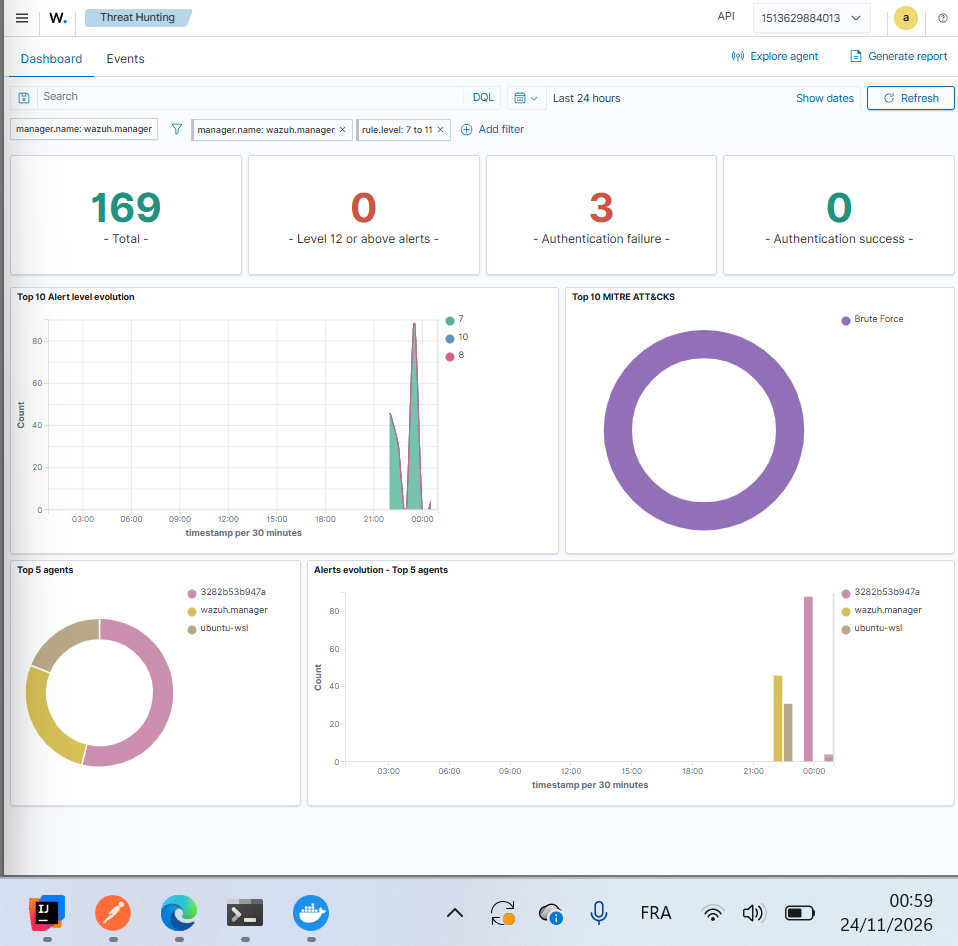
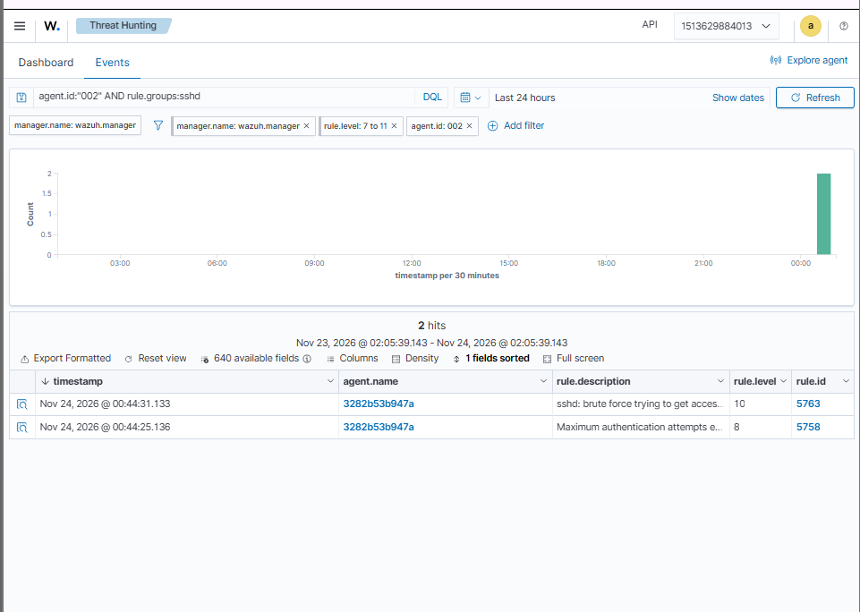
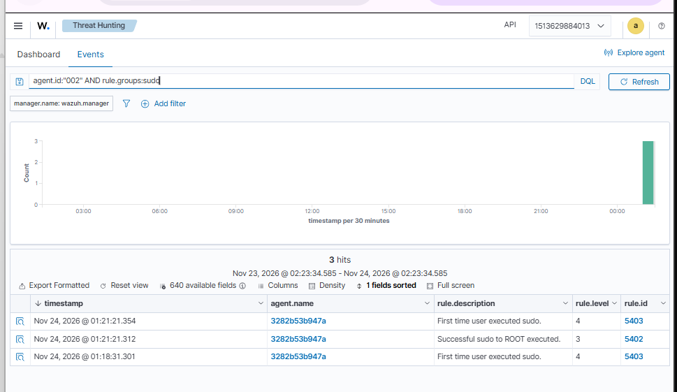
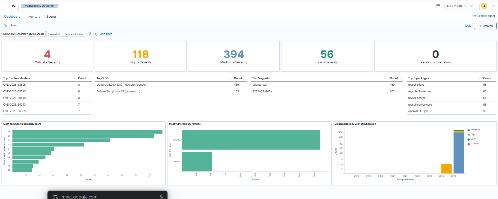

# Supervision et détection : Wazuh

**Objectif** : déployer Wazuh avec Docker, configurer un agent de supervision, surveiller des événements de sécurité, détecter des tentatives d'intrusion (force brute SSH, élévation de privilèges) et analyser les vulnérabilités (CVE) des systèmes supervisés.

Wazuh n'est **pas intégré au pipeline Jenkins**. C'est un outil de supervision à part, qui tourne en continu sur des systèmes déployés, pendant que le pipeline (SAST, SCA, scan d'image, DAST) agit avant le déploiement. Les deux approches sont complémentaires : le pipeline empêche des failles connues d'arriver en production, Wazuh détecte ce qui se passe réellement sur les systèmes qui tournent, y compris des attaques qui n'ont rien à voir avec une faille de code.

## Où ça se situe par rapport aux autres outils

| | SAST / SCA / Trivy / ZAP | Wazuh |
|---|---|---|
| Quand | avant et pendant le déploiement | en continu, après le déploiement |
| Ce qu'il regarde | code, dépendances, image, application en test | systèmes en fonctionnement (logs, processus, inventaire) |
| Type de résultat | failles à corriger avant la mise en production | alertes sur des événements réels (tentative d'intrusion, activité suspecte) |
| Rôle | prévention | détection |

## Architecture de l'atelier

Trois ensembles de conteneurs indépendants, avec leur propre `docker compose` ou lancés à la main, sans lien avec le pipeline Jenkins :

| Ensemble | Rôle |
|---|---|
| `devsecops-workshop` (racine du dépôt) | Jenkins, SonarQube, staging de l'application — inchangé |
| Pile Wazuh (dépôt officiel `wazuh-docker`, cloné à part) | Wazuh manager, indexer, dashboard |
| `wazuh-target` | conteneur « cible » : serveur SSH avec un agent Wazuh installé |
| `wazuh-attacker` | conteneur attaquant : Hydra, pour simuler une force brute SSH |

Ce choix évite de mélanger la preuve que le pipeline protège l'application (staging) avec la démonstration de supervision d'un système (Wazuh), qui a des besoins très différents (SSH, sudo, syslog).

## 1. Déployer la pile Wazuh

```bash
mkdir -p wazuh && cd wazuh
git clone https://github.com/wazuh/wazuh-docker.git -b v4.14.6
cd wazuh-docker/single-node

# Linux, et WSL2 sous Windows avec Docker Desktop
sudo sysctl -w vm.max_map_count=262144
# Sous Docker Desktop (Windows), si la commande ci-dessus échoue :
# wsl -d docker-desktop sysctl -w vm.max_map_count=262144

# Générer les certificats
docker compose -f generate-indexer-certs.yml run --rm generator

docker compose up -d
```

- Tableau de bord : `https://localhost` (certificat auto-signé, avertissement du navigateur normal).
- Identifiants par défaut dans `wazuh-docker/single-node/docker-compose.yml` : **à changer avant d'aller plus loin**, avec l'outil de mots de passe fourni dans le dépôt officiel.
- Le dossier `wazuh-docker/` cloné n'est **jamais commité** (il contient ses propres certificats et mots de passe) : ajouter `wazuh-docker/` au `.gitignore` du dossier `wazuh/`.

### Mémoire

Cette pile seule demande au moins 4 Go de RAM. Avec Jenkins et SonarQube déjà lancés, portez l'allocation de Docker Desktop à **10-12 Go** si possible, ou arrêtez temporairement le projet workshop (`docker compose stop`, pas `down -v`) pendant cette partie.

## 2. Conteneur cible

`wazuh/target/Dockerfile` :

```dockerfile
FROM debian:12-slim

RUN apt-get update && apt-get install -y --no-install-recommends \
      openssh-server rsyslog sudo curl gnupg ca-certificates lsb-release \
    && mkdir -p /var/run/sshd /run/sshd \
    && ssh-keygen -A \
    && rm -rf /var/lib/apt/lists/*

# Utilisateur de test, mot de passe volontairement faible pour la démo de force brute
RUN useradd -m -s /bin/bash demo \
    && echo 'demo:password123' | chpasswd \
    && usermod -aG sudo demo

COPY sshd_config /etc/ssh/sshd_config

EXPOSE 22
CMD ["/bin/sh", "-c", "rsyslogd -n & /usr/sbin/sshd -D"]
```

`wazuh/target/sshd_config` : partir de la configuration par défaut de Debian, avec au moins :

```
PermitRootLogin no
PasswordAuthentication yes
LogLevel VERBOSE
```

`rsyslog` est nécessaire car, dans un conteneur minimal, `sshd` et `sudo` écrivent via syslog : sans lui, rien n'apparaît dans `/var/log/auth.log`, le fichier que l'agent Wazuh surveille.

```bash
docker network create wazuh-net 2>/dev/null
docker build -t wazuh-target ./wazuh/target
docker run -d --name wazuh-target --network wazuh-net -p 2222:22 wazuh-target
docker ps --filter name=wazuh-target
```

Le conteneur cible doit être sur le **même réseau Docker** que le manager Wazuh pour pouvoir s'y connecter (réseau créé par le `docker compose` du dépôt officiel, par exemple `single-node_default`, à vérifier avec `docker network ls`).

### Installer l'agent

```bash
# Récupérer l'adresse IP du manager Wazuh
docker inspect single-node-wazuh.manager-1 --format '{{.NetworkSettings.Networks.single-node_default.IPAddress}}'

docker exec wazuh-target bash -c "
  curl -so wazuh-agent.deb https://packages.wazuh.com/4.x/apt/pool/main/w/wazuh-agent/wazuh-agent_4.14.6-1_amd64.deb &&
  WAZUH_MANAGER='<IP_DU_MANAGER>' dpkg -i wazuh-agent.deb &&
  /var/ossec/bin/wazuh-control start
"
```

Important : définir `WAZUH_MANAGER` **dans la même commande** que l'installation (`dpkg -i`). Si la configuration de l'agent est finalisée dans une commande séparée sans cette variable, le script écrit littéralement `MANAGER_IP` dans `/var/ossec/etc/ossec.conf`, et l'agent refuse de démarrer (`Invalid server address found: 'MANAGER_IP'`). Correction si ça arrive :

```bash
docker exec wazuh-target sed -i "s/MANAGER_IP/<IP_DU_MANAGER>/" /var/ossec/etc/ossec.conf
docker exec wazuh-target /var/ossec/bin/wazuh-control restart
```

Vérifier le résultat :

```bash
docker exec wazuh-target /var/ossec/bin/wazuh-control status
```

Puis, dans le tableau de bord, menu *Agents* : le conteneur doit apparaître et passer à l'état **Active**.

## 3. Conteneur attaquant

`wazuh/attacker/Dockerfile` :

```dockerfile
FROM kalilinux/kali-rolling
RUN apt-get update && apt-get install -y --no-install-recommends hydra \
    && rm -rf /var/lib/apt/lists/*
```

```bash
docker build -t wazuh-attacker ./wazuh/attacker
echo -e "123456\npassword\npassword123" > /tmp/wordlist.txt
docker run --rm --network <reseau_commun> -v /tmp/wordlist.txt:/wordlist.txt wazuh-attacker \
  hydra -l demo -P /wordlist.txt ssh://wazuh-target
```

`password123` doit figurer dans la liste, pour obtenir une connexion réussie après plusieurs échecs et observer les deux types d'alertes (échec puis succès).

**Ne jamais publier le port SSH de la cible vers l'extérieur du réseau Docker.** L'attaque ne doit viser que les conteneurs de cet atelier, sur le réseau Docker isolé.

## 4. Élévation de privilèges

Depuis une session sur la cible :

```bash
docker exec -it wazuh-target su - demo
su - root        # échoue sans le bon mot de passe : alerte
sudo whoami      # avec le bon mot de passe : succès, mais tracé
```

## Résultats

> **Portée des résultats** : le tableau de bord *Vulnerability Detection* peut afficher d'autres agents que la cible de l'atelier si un agent a été installé ailleurs (par exemple sur la machine de l'opérateur). Les résultats ci-dessous ne portent que sur l'agent cible de cet atelier (identifiant `002`, nom d'hôte du conteneur) : toute capture ou export doit être filtré sur cet `agent.id`, et un agent hors périmètre (poste personnel, par exemple) doit être retiré du tableau de bord avant publication (*Agents > (agent concerné) > Delete*), pour ne pas exposer l'inventaire logiciel d'une machine personnelle.

### Force brute SSH

Attaque lancée depuis `wazuh-attacker` contre `wazuh-target` (agent Wazuh `002`).




| Règle | Niveau | Description |
|---|---|---|
| 5758 | 8 | Maximum authentication attempts exceeded |
| 5763 | 10 | sshd: brute force trying to get access |

Wazuh classe ces deux règles sous la technique MITRE ATT&CK **Brute Force**, visible dans le widget *Top 10 MITRE ATT&CKs* du tableau de bord.

### Élévation de privilèges

Après une connexion réussie sur la cible, exécution de `sudo` :



| Règle | Niveau | Description |
|---|---|---|
| 5403 | 4 | First time user executed sudo |
| 5402 | 3 | Successful sudo to ROOT executed |

Ces alertes sont de niveau bas : un `sudo` réussi est un événement normal en soi, Wazuh le journalise pour garder une trace, pas pour signaler une attaque à lui seul. C'est la corrélation avec l'alerte de force brute qui précède, sur le même agent et dans la même fenêtre de temps, qui rend la séquence suspecte : un compte vient d'être compromis par force brute, puis utilisé pour obtenir les droits root.

### Détection de vulnérabilités (CVE)

Module *Vulnerability Detection*, à partir de l'inventaire de paquets collecté par l'agent.



Sur l'agent cible (Debian 12 bookworm, 103 paquets inventoriés), les CVE les plus représentées touchent des paquets système Debian. Certaines, telles que `CVE-2026-53613` et `CVE-2026-78410`, apparaissent aussi dans le scan Trivy de l'image Docker de l'application sur la même base Debian 12 (voir [docs/trivy.md](docs/trivy.md)).

### Comparaison avec Trivy

Les deux outils regardent la même réalité par deux méthodes différentes :

| | Trivy | Wazuh (Vulnerability Detection) |
|---|---|---|
| Moment | avant le déploiement, sur l'image | en continu, sur le système **en fonctionnement** |
| Source | couches de l'image Docker | inventaire de paquets collecté par l'agent |
| Avantage | bloque une image vulnérable avant qu'elle ne tourne | détecte une CVE publiée après coup sur un système déjà déployé, sans attendre un nouveau build |
| Limite | ne voit rien après le déploiement (l'image peut diverger du système réel avec le temps) | ne protège rien avant le déploiement ; nécessite un agent installé et actif |

Une CVE corrigée dans l'image mais retrouvée par Wazuh sur le système réel indiquerait une dérive entre l'image construite et ce qui tourne réellement (modification manuelle du conteneur, par exemple) : un signal à ne pas ignorer.

## Discussion : la supervision dans une démarche DevSecOps

- **Détection ne veut pas dire blocage.** Wazuh a ici un rôle passif : il observe et alerte, il ne bloque pas l'attaquant. Une « active response » (bannir une IP automatiquement, par exemple) est possible mais volontairement non activée dans cet atelier : elle introduit un risque d'auto-blocage (un faux positif qui bannirait un utilisateur légitime) et doit être testée avec précaution avant toute mise en production.
- **Le niveau d'alerte guide le tri, pas une alarme binaire.** Une règle de niveau 3 ou 4 (sudo réussi) n'est pas en soi un incident ; une règle de niveau 10 (force brute) l'est. Un SIEM utile se configure pour que les analystes regardent d'abord les niveaux élevés, puis remontent le fil des événements liés plutôt que de traiter chaque ligne isolément.
- **La corrélation temporelle fait l'histoire.** Prise séparément, chaque alerte sudo est anodine. Reliée à l'alerte de force brute sur le même agent, elle devient le signe d'une compromission suivie d'une élévation de privilèges : le scénario MITRE ATT&CK classique *Initial Access* puis *Privilege Escalation*.
- **Un agent hors périmètre fausse les résultats.** Si un agent qui n'est pas destiné au test (poste personnel, par exemple) reste enregistré, il mélange ses propres vulnérabilités et événements à ceux de la démonstration. D'où l'intérêt de toujours filtrer par `agent.id` et de retirer les agents non voulus avant de documenter ou publier des résultats.
- **Faux positifs et réglage des règles.** Un serveur légitime avec plusieurs tentatives de connexion manquées (mot de passe oublié) peut déclencher la même règle qu'une vraie attaque. Un déploiement réel affine les règles et les seuils, et ne se contente pas des réglages par défaut.
- **Complémentarité avec le pipeline.** Le pipeline (SAST, SCA, Trivy, ZAP) réduit le nombre de failles qui arrivent en production. Wazuh détecte ce qui se passe malgré tout, y compris des attaques qui ne viennent pas d'une faille de code (mot de passe faible, ingénierie sociale, etc.). Aucun des deux ne remplace l'autre.
- **Boucle de retour vers le développement.** Une vulnérabilité détectée par Wazuh sur un système en production (comme une CVE sur un paquet) doit remonter vers l'équipe qui maintient l'image ou l'infrastructure, de la même façon qu'un résultat de Trivy ou de Dependency-Check : la supervision alimente le backlog de corrections, elle ne le remplace pas.
