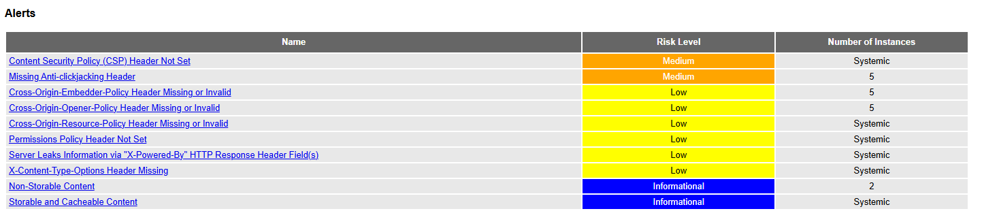
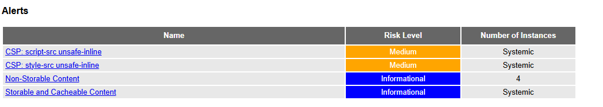

# DAST : OWASP ZAP

**Objectif** : découvrir et utiliser OWASP ZAP pour identifier les failles de sécurité d'une application web **en cours d'exécution**.

## SAST, SCA, DAST : trois angles différents

| | SAST | SCA | DAST |
|---|---|---|---|
| Analyse | le code source | les dépendances | l'application **déployée**, de l'extérieur |
| Outils du workshop | SonarQube, Semgrep | Dependency-Check, Dependabot | OWASP ZAP |
| Trouve | injections, secrets, mauvaises pratiques | CVE dans les paquets | en-têtes manquants, cookies faibles, erreurs de configuration, injections exploitables |
| Limite | ne voit pas la configuration au runtime | ne voit pas notre code | ne voit que ce qu'il atteint en explorant l'application |

## Fonctionnement dans le pipeline

Pipeline : `Checkout` > `Install & Build` > `SAST` > `SCA` > `Docker Build` > `Deploy Staging` > `DAST`

- **Cible** : `http://devsecops-staging:3000`. Le staging et ZAP sont sur le réseau Docker `devsecops`, donc ZAP atteint l'application par le nom de conteneur.
- **Outil** : image `ghcr.io/zaproxy/zaproxy:stable`, lancée par Jenkins via le socket Docker. Le premier build télécharge l'image (environ 1 Go).
- **Scan par défaut : baseline (passif)**. ZAP explore l'application pendant environ 1 minute (spider) et analyse les réponses. Il n'envoie aucune attaque.
- **Scan actif (facultatif)** : build avec le paramètre `ZAP_ACTIVE_SCAN` coché. ZAP envoie de vraies charges d'attaque (XSS, injections). À réserver au **staging**, jamais à la production.
- **Rapports** : `zap-report/zap-report.html` et `zap-report.json`, archivés comme artefacts du build.
- **Mode observation** : l'option `-I` empêche les warnings de faire échouer le build. Seule une erreur de ZAP (code 3, par exemple cible injoignable) fait échouer le stage.

| Code de sortie ZAP | Signification | Effet sur le build |
|---|---|---|
| 0 | Aucune alerte | OK |
| 1 | Alerte de niveau FAIL | OK en mode observation |
| 2 | Warnings | OK en mode observation |
| 3 | Erreur ZAP | Échec |

## Lancer ZAP à la main (atelier)

Le staging doit tourner (conteneur `devsecops-staging`, démarré par le pipeline). Depuis un terminal à la racine du projet :

```bash
docker rm -f zap-scan 2>/dev/null

MSYS_NO_PATHCONV=1 docker run --name zap-scan --user root --network devsecops \
  ghcr.io/zaproxy/zaproxy:stable \
  sh -c "mkdir -p /zap/wrk && zap-baseline.py -t http://devsecops-staging:3000 -r zap-report.html -J zap-report.json -I"

mkdir -p zap-report
MSYS_NO_PATHCONV=1 docker cp zap-scan:/zap/wrk/. zap-report/
docker rm zap-scan
```

Ouvrir ensuite `zap-report/zap-report.html` dans un navigateur.

> **Windows (Git Bash)** : Git Bash réécrit les chemins qui commencent par `/`, ce qui casse les montages de volume (`-v ...:/zap/wrk`) et fait afficher l'aide de ZAP au lieu de lancer le scan. La méthode ci-dessus n'utilise aucun montage (le rapport est extrait avec `docker cp`) et le préfixe `MSYS_NO_PATHCONV=1` désactive la réécriture. Sous PowerShell ou Linux, ce préfixe est inutile.

## Lire le rapport

Le rapport classe les alertes par niveau de risque (High, Medium, Low, Informational). Pour chaque alerte, il indique les URL concernées, une description et une solution. Alertes rencontrées sur cette application :

| Alerte ZAP | Risque | Correctif |
|---|---|---|
| Content Security Policy (CSP) Header Not Set | une XSS est plus facile à exploiter | en-tête `Content-Security-Policy` |
| Missing Anti-clickjacking Header | l'application peut être affichée dans une iframe piégée | `X-Frame-Options` ou `frame-ancestors` |
| X-Content-Type-Options Header Missing | interprétation incorrecte du type de contenu par le navigateur | `X-Content-Type-Options: nosniff` |
| Server Leaks Information via "X-Powered-By" | le serveur révèle sa technologie, ce qui aide un attaquant | `poweredByHeader: false` |
| Permissions Policy Header Not Set | accès non restreint aux API du navigateur (caméra, micro...) | en-tête `Permissions-Policy` |
| Cross-Origin-Opener-Policy Header Missing or Invalid | une page ouverte depuis un autre site peut garder une référence vers la fenêtre | `Cross-Origin-Opener-Policy: same-origin` |
| Cross-Origin-Embedder-Policy Header Missing or Invalid | pas d'isolation contre les ressources inter-origines | `Cross-Origin-Embedder-Policy: require-corp` |
| Cross-Origin-Resource-Policy Header Missing or Invalid | d'autres sites peuvent charger nos ressources | `Cross-Origin-Resource-Policy: same-origin` |
| CSP: Failure to Define Directive with No Fallback | une directive absente (ici `form-action`) équivaut à tout autoriser | ajouter `form-action 'self'` |
| CSP: script-src unsafe-inline / style-src unsafe-inline | la CSP autorise les scripts et styles inline, ce qui affaiblit sa protection contre la XSS | CSP à nonce (voir « Alertes restantes ») |
| Storable and Cacheable Content | une réponse sensible pourrait être conservée par un cache partagé | `Cache-Control: no-store` sur les réponses sensibles |
| Non-Storable Content | informatif : la réponse n'est pas mise en cache | aucune action |
| Cookie No HttpOnly Flag / Cookie without Secure Flag | vol du cookie par XSS, ou interception en clair | `httpOnly: true`, `secure: true` |

Les alertes exactes dépendent de la version de ZAP et de celle de Next.js : se fier au rapport généré.

### À propos des cookies

Le scan baseline ne soumet pas de formulaire et ne s'authentifie pas : dans le rapport, 100 % des endpoints découverts sont des requêtes `GET`. Le cookie `session` n'est posé que par `POST /api/login` (appel JSON déclenché par du JavaScript), donc ZAP ne le voit pas en mode passif. Pour vérifier les attributs du cookie, deux possibilités :

- à la main : `curl -i -X POST http://localhost:3001/api/login -H "Content-Type: application/json" -d '{"username":"admin","password":"x"}'` et lire l'en-tête `Set-Cookie` ;
- avec ZAP en mode manuel (proxy ou HUD) en se connectant depuis le navigateur, ou avec un scan authentifié.

## Scan actif

Le scan actif (`zap-full-scan.py`) ajoute des attaques aux requêtes découvertes. Pour le lancer depuis Jenkins : *Build with Parameters* et cocher `ZAP_ACTIVE_SCAN`. Il est plus long (plusieurs minutes).

ZAP ne trouve que ce que son spider atteint. Les liens `/api/ping?host=...` et `/api/file?name=...` de la page d'accueil sont explorés, mais les appels faits uniquement en JavaScript (login, recherche) ne le sont pas.

Pour voir ZAP détecter de vraies injections, il faut le lancer sur l'état **vulnérable** du code. Comme le pipeline s'arrête au SAST sur cette version, le faire à la main (branche `vulnerable`) :

```bash
git checkout vulnerable
docker build -t devsecops-app:vuln .
docker run -d --name vuln-app --network devsecops devsecops-app:vuln

docker rm -f zap-scan 2>/dev/null
MSYS_NO_PATHCONV=1 docker run --name zap-scan --user root --network devsecops \
  ghcr.io/zaproxy/zaproxy:stable \
  sh -c "mkdir -p /zap/wrk && zap-full-scan.py -t http://vuln-app:3000 -r zap-full.html -I"

mkdir -p zap-full-report
MSYS_NO_PATHCONV=1 docker cp zap-scan:/zap/wrk/. zap-full-report/
docker rm zap-scan
docker rm -f vuln-app
```

## Corrections appliquées

Ajout des en-têtes de sécurité, suppression de `X-Powered-By` et désactivation du cache sur les routes d'API, dans `next.config.js` :

```js
/** @type {import('next').NextConfig} */
const nextConfig = {
  // ... options existantes (serverExternalPackages, etc.)
  poweredByHeader: false,
  async headers() {
    return [
      {
        source: '/(.*)',
        headers: [
          { key: 'X-Content-Type-Options', value: 'nosniff' },
          { key: 'X-Frame-Options', value: 'DENY' },
          { key: 'Referrer-Policy', value: 'strict-origin-when-cross-origin' },
          { key: 'Permissions-Policy', value: 'camera=(), microphone=(), geolocation=()' },
          { key: 'Cross-Origin-Opener-Policy', value: 'same-origin' },
          { key: 'Cross-Origin-Embedder-Policy', value: 'require-corp' },
          { key: 'Cross-Origin-Resource-Policy', value: 'same-origin' },
          {
            key: 'Content-Security-Policy',
            value: "default-src 'self'; script-src 'self' 'unsafe-inline'; style-src 'self' 'unsafe-inline'; img-src 'self' data:; frame-ancestors 'none'; form-action 'self'; base-uri 'self'",
          },
        ],
      },
      {
        source: '/api/:path*',
        headers: [{ key: 'Cache-Control', value: 'no-store' }],
      },
    ];
  },
};
module.exports = nextConfig;
```

Les trois en-têtes `Cross-Origin-*` sont sans risque ici car l'application ne charge aucune ressource externe. Sur une application qui en charge (CDN, images distantes), `Cross-Origin-Embedder-Policy: require-corp` casserait ces chargements.

## Avant / après

**Avant** : alertes sur les en-têtes manquants.



**Après** : en-têtes ajoutés et CSP complétée.



| | Avant | Après 1re correction (en-têtes) | Après CSP complète |
|---|---|---|---|
| Medium | 2 | 3 | 2 |
| Low | 6 | 0 | 0 |
| Informational | 2 | 2 | 2 |
| **Total** | **10** | **5** | **4** |

Le nombre de Medium monte à 3 après la première correction parce que ZAP ne se contente plus de signaler l'absence de CSP : il en analyse le contenu et relève une directive manquante (`form-action`). Ajouter `form-action` et `base-uri` le ramène à 2.

### Alertes restantes et décisions

| Alerte | Décision |
|---|---|
| CSP: script-src unsafe-inline | **Risque accepté** : Next.js injecte des scripts inline pour l'hydratation. Correction possible avec une CSP à nonce générée par requête (middleware/proxy), au prix d'un rendu dynamique de toutes les pages. |
| CSP: style-src unsafe-inline | **Risque accepté** : l'application utilise des attributs `style={{...}}`. Correction : déplacer les styles dans une feuille CSS, puis utiliser un nonce. |
| Storable and Cacheable Content | **Informationnel** : ne concerne plus que les pages publiques statiques et les fichiers `/_next/static` (nom haché, cache d'un an, comportement normal). Aucune donnée sensible. |
| Non-Storable Content | **Informationnel** : confirme que `Cache-Control: no-store` s'applique bien aux routes `/api/*`, ainsi qu'à `robots.txt` et `sitemap.xml`. |

L'alerte `form-action` est **corrigée** (confirmé par ce scan), et `Cache-Control: no-store` est **vérifié** sur `/api/*`.

Une CSP présente mais permissive vaut mieux que pas de CSP, sans être idéale : c'est un bon point de discussion sur le compromis entre sécurité et compatibilité avec le framework.
## Passer en mode bloquant

En mode observation, un warning ne casse pas le build. Pour faire échouer le build sur certaines règles, ZAP lit un fichier de configuration (`-c`) où chaque règle est classée `IGNORE`, `WARN` ou `FAIL`. Le générer avec l'option `-g`, passer les règles voulues en `FAIL` (par exemple les cookies et la CSP), puis le fournir à ZAP avec `-c` en retirant `-I`.

## Discussion : le DAST dans un pipeline CI/CD

- **Complémentarité** : le DAST trouve ce que le SAST ne voit pas (configuration, en-têtes, comportement réel) et inversement. Aucun outil ne suffit seul.
- **Où le placer** : après le déploiement sur un environnement de test, jamais avant (il faut une application qui tourne).
- **Baseline à chaque build, scan actif à la demande ou la nuit** : le passif est rapide et sans risque ; l'actif est lent et envoie de vraies attaques.
- **Jamais en production** : un scan actif peut créer des données, déclencher des alertes ou dégrader le service. Utiliser un environnement jetable ou de pré-production.
- **Couverture limitée** : ZAP ne teste que ce qu'il découvre. Les parcours derrière une authentification ou accessibles seulement en JavaScript demandent une configuration (contexte, utilisateur, import OpenAPI).
- **Faux positifs et risques acceptés** : trier les résultats, puis classer en `IGNORE` les alertes justifiées et les documenter (comme `unsafe-inline` ici) plutôt que de laisser un rapport bruyant que personne ne lit.
- **Durcir progressivement** : observation d'abord, puis blocage sur les alertes critiques, comme pour le SAST. Un seuil trop strict dès le départ fait désactiver l'outil.
- **Rapport comme preuve** : archiver le rapport HTML pour chaque build permet de suivre l'évolution et de justifier les décisions.